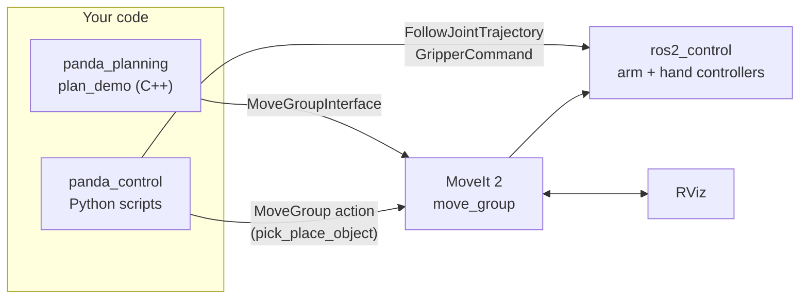
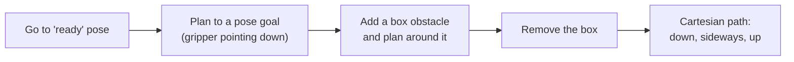

<p align="center">
  
</p>

<p align="center">
  
  
  
  
  
</p>

<p align="center">
  <b>Make a Franka Panda arm plan, avoid obstacles, and pick up objects, all in simulation.</b>
</p>

---

## ✨ What's inside

| Package | Language | What it does |
| --- | --- | --- |
| 🧠 **`panda_planning`** | C++ | MoveIt 2 demo: named poses, pose goals, obstacle avoidance and Cartesian paths. |
| 🕹️ **`panda_control`** | Python | Scripts that drive the arm and gripper, from simple joint moves to a full interactive pick and place. |

## 🎬 Demo

<!-- Add your own screenshot or GIF of RViz here, for example:
<p align="center"></p>
-->

Run the pick and place and watch the arm in RViz:

1. 🤏 Opens the gripper and hovers above the red box.
2. ⬇️ Moves straight down and closes the gripper.
3. 📦 Lifts the box and carries it to the new spot.
4. ⬇️ Sets it down, opens the gripper and retreats.

## 🏗️ How it fits together



## 🧰 Requirements

- Ubuntu with **ROS 2 Humble**
- [MoveIt 2](https://moveit.ros.org/) and the Panda demo configuration:

```bash
sudo apt install ros-humble-moveit ros-humble-moveit-resources-panda-moveit-config
```

- `colcon` and `rosdep`

## 🔨 Build

```bash
git clone https://github.com/mubiii24/panda_ws.git
cd panda_ws
source /opt/ros/humble/setup.bash
rosdep install --from-paths src --ignore-src -r -y
colcon build --symlink-install
source install/setup.bash
```

> `src/franka_ros2`, `src/franka_description` and `src/moveit_resources` are empty in this repository. Clone them into `src/` yourself if you need them.

## 🚀 Usage

Every script needs the Panda MoveIt demo running first. It starts RViz, MoveIt and the arm and gripper controllers (`panda_arm_controller`, `panda_hand_controller`):

```bash
# Terminal 1
source install/setup.bash
ros2 launch moveit_resources_panda_moveit_config demo.launch.py
```

Then run any of the following in a second terminal (after sourcing `install/setup.bash`).

### MoveIt planning demo

```bash
ros2 launch panda_planning plan_demo.launch.py
```



### Control scripts

| Command | What it does |
| --- | --- |
| `ros2 run panda_control move_arm` | Moves the arm between a few fixed joint poses and back to ready. |
| `ros2 run panda_control pick_place` | Pick and place using fixed joint poses and gripper commands. |
| `ros2 run panda_control pick_place_object` | ⭐ Interactive pick and place. Asks for pick and place positions, adds a table and a box to the planning scene, plans collision-free moves and attaches the box while carrying it. |
| `ros2 run panda_control manual_path` | Plays a hand-written joint path. Edit the `PATH` list at the top of the file. Joint limits are checked first. |
| `ros2 run panda_control record_path` | Records joint positions you set in RViz. Press Enter to save a point, `q` to finish. Saves to `~/panda_path.json`. |
| `ros2 run panda_control play_path` | Replays the path saved by `record_path`, with a speed limit. |

### 🎯 Interactive pick and place

```bash
ros2 run panda_control pick_place_object
```

Press Enter to accept the default in brackets, or type your own `x y` in metres:

```
Where is the object? PICK (x y in metres) [0.4 0.25]:
Where should it go? PLACE (x y in metres) [0.4 -0.25]:
```

Positions are in the robot base frame. Keep them inside these limits:

| Limit | Value |
| --- | --- |
| `x` | 0.30 to 0.60 |
| `y` | -0.40 to 0.40 |
| Distance from base | under 0.58 |
| Pick to place distance | at least 0.10 |

### 🔁 Record and replay a path

```bash
ros2 run panda_control record_path   # move the arm in RViz, press Enter at each pose
ros2 run panda_control play_path     # replay it
```

## 📁 Project structure

```
panda_ws/
├── docs/
│   └── banner.svg
└── src/
    ├── panda_control/        # Python package (ament_python)
    │   └── panda_control/
    │       ├── move_arm.py
    │       ├── pick_place.py
    │       ├── pick_place_object.py
    │       ├── manual_path.py
    │       ├── record_path.py
    │       └── play_path.py
    └── panda_planning/       # C++ package (ament_cmake)
        ├── src/plan_demo.cpp
        └── launch/plan_demo.launch.py
```

## ⚠️ Safety

These scripts are written for simulation. Before running anything on a real robot, check the joint poses, speeds and workspace limits in the code.

## 📄 License

`panda_control` declares the MIT license in its `package.xml`. See the `LICENSE` file for details.

## 👤 Author

Made by **mubii** ([@mubiii24](https://github.com/mubiii24)).
